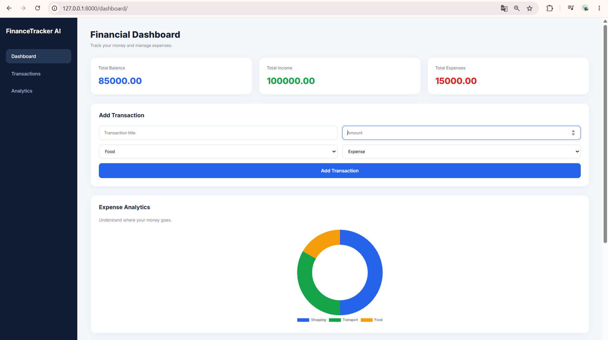

# FinanceTracker AI

[](https://github.com/Nurzhikko/FinanceTracker-AI/actions/workflows/tests.yml)

A full-stack personal finance management web application built with **Python, FastAPI, SQLite, and JavaScript**, featuring secure JWT authentication, user-specific financial data, interactive analytics, and automated testing.

## Application Preview



## Overview

FinanceTracker AI helps users manage income and expenses, track account balances, and visualize spending habits through an interactive dashboard.

The application demonstrates backend API development, user authentication, relational databases, frontend integration, automated testing, and continuous integration.

## Key Features

### Authentication and Security
- User registration and login
- Secure password hashing with Argon2
- JWT-based authentication
- Protected API endpoints
- User-specific transaction management
- Environment-based JWT secret configuration
- Input validation with Pydantic

### Financial Management
- Create, read, update, and delete transactions
- Categorize income and expenses
- Track total income, total expenses, and account balance
- View recent transactions
- Analyze spending by category
- Interactive visualizations powered by Chart.js

### Engineering
- RESTful API with FastAPI
- SQLite database with persistent storage
- Modular backend architecture using API routers
- Automated API tests using pytest
- Continuous integration with GitHub Actions
- Interactive Swagger API documentation

## Tech Stack

| Layer | Technologies |
|---|---|
| Backend | Python, FastAPI, Pydantic |
| Database | SQLite |
| Authentication | JWT, PyJWT, Argon2, pwdlib |
| Frontend | HTML5, CSS3, JavaScript |
| Data Visualization | Chart.js |
| Testing | pytest, FastAPI TestClient |
| CI/CD | GitHub Actions |
| Development | Git, GitHub, VS Code |

## Project Structure

```text
FinanceTracker-AI/
├── .github/
│   └── workflows/
│       └── tests.yml
├── assets/
│   └── dashboard.png
├── frontend/
│   ├── index.html
│   ├── style.css
│   └── script.js
├── routers/
│   ├── auth.py
│   ├── transactions.py
│   └── analytics.py
├── tests/
│   └── test_api.py
├── main.py
├── database.py
├── models.py
├── security.py
├── requirements.txt
├── .gitignore
└── README.md
```

## Getting Started

### 1. Clone the Repository

```bash
git clone https://github.com/Nurzhikko/FinanceTracker-AI.git
cd FinanceTracker-AI
```

### 2. Create a Virtual Environment

```bash
python -m venv .venv
```

Activate it on Windows PowerShell:

```powershell
.\.venv\Scripts\Activate.ps1
```

### 3. Install Dependencies

```bash
python -m pip install -r requirements.txt
```

### 4. Configure Environment Variables

Create a `.env` file in the project root:

```dotenv
JWT_SECRET_KEY=replace_with_your_own_random_secret
```

Generate a secure secret using Python:

```bash
python -c "import secrets; print(secrets.token_hex(32))"
```

Replace the placeholder with the generated value.

**Never commit your `.env` file or secret keys to GitHub.**

JWT access tokens expire after 30 minutes by default.

### 5. Run the Application

```bash
python -m uvicorn main:app --reload
```

The application initializes the SQLite database during startup.

### 6. Open the Dashboard

Dashboard: http://127.0.0.1:8000/dashboard/

API documentation: http://127.0.0.1:8000/docs

Register an account, sign in, and start managing transactions.

## API Endpoints

### Authentication

| Method | Endpoint | Description |
|---|---|---|
| POST | `/auth/register` | Register a new user |
| POST | `/auth/login` | Authenticate and receive a JWT |
| GET | `/auth/me` | Get the authenticated user's profile |

### Transactions

| Method | Endpoint | Description |
|---|---|---|
| GET | `/transactions` | List the user's transactions |
| POST | `/transactions` | Create a transaction |
| PUT | `/transactions/{id}` | Update a transaction |
| DELETE | `/transactions/{id}` | Delete a transaction |

### Analytics

| Method | Endpoint | Description |
|---|---|---|
| GET | `/analytics/summary` | Get income, expenses, and balance |
| GET | `/analytics/categories` | Get category-based analytics |

All transaction and analytics endpoints require JWT authentication. Users can only access transactions associated with their own accounts.

## Automated Testing

Run the test suite:

```bash
python -m pytest tests/ -v
```

The project includes 19 automated API tests covering core features, validation, authentication, and error handling.

GitHub Actions automatically runs the test workflow when changes are pushed to the repository.

[View CI Workflow](https://github.com/Nurzhikko/FinanceTracker-AI/actions)

## Architecture

The application uses a modular full-stack architecture:

- **Frontend:** HTML, CSS, and JavaScript handle the user interface, forms, and financial charts.
- **API:** FastAPI processes HTTP requests and validates data.
- **Authentication:** JWT identifies authenticated users and protects private endpoints.
- **Database:** SQLite stores users and their financial transactions.
- **Analytics:** Backend endpoints calculate financial summaries and category statistics.
- **Testing:** pytest and GitHub Actions help verify application behavior.

## Future Improvements

- PostgreSQL integration
- Password recovery and email verification
- Login rate limiting
- Monthly spending reports
- Budget limits and notifications
- Multi-currency support
- AI-powered expense categorization
- Cloud deployment

## Author

**Nurzhigit Zhumabek**

GitHub: https://github.com/Nurzhikko

## Project Status

**Active Development — Portfolio Project**

Built to demonstrate practical full-stack development, REST API design, authentication, database integration, and automated testing.